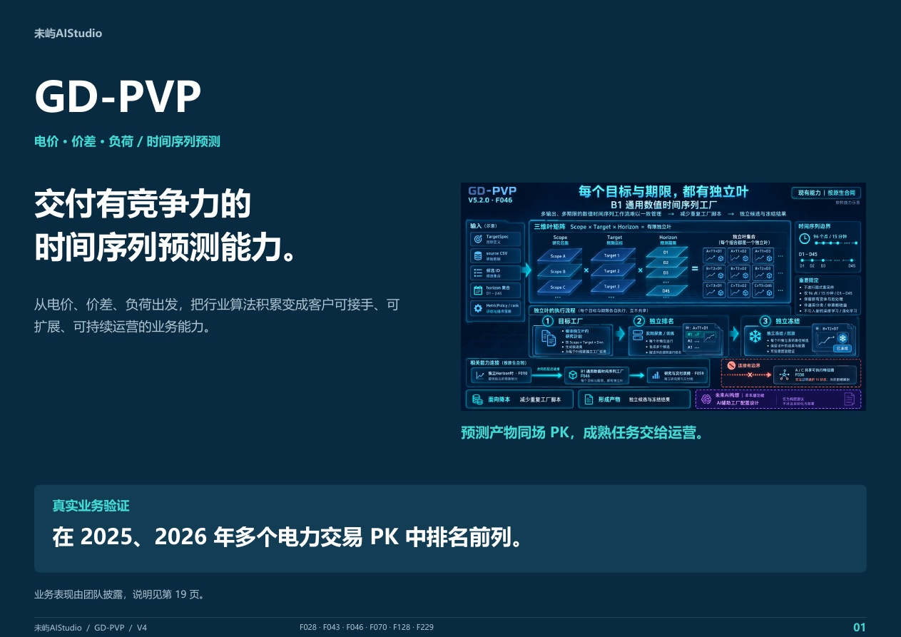

# GD-PVP

**交付有竞争力的时间序列预测能力。**

从电价、价差、负荷出发，把行业算法积累变成客户可接手、可扩展、可持续运营的业务能力。

## [打开完整宣传册 · 在线阅读 ↗](https://weiyuaistudio.github.io/GD-PVP/)

**[在线阅读 ↗](https://weiyuaistudio.github.io/GD-PVP/)** · **[下载 PDF](https://weiyuaistudio.github.io/GD-PVP/downloads/GD-PVP_V4_Brochure.pdf)** · **[业务咨询](mailto:weiyuaistudio@outlook.com?subject=GD-PVP%20%7C%20Collaboration)**

## 从预测产物，到持续运营

- **拿结果比较**：将 GD-PVP 与客户指定方案放到同一业务任务，以约定的可用信息、评价周期和指标进行比较。
- **拿能力交付**：按约定交付模型、特征状态、后处理与运行依赖，让团队接手运行。
- **拿方法继续做**：通过任务配置、实验组织和版本记录，把已有积累用于后续研究与改进。

完整宣传册共 20 页，提供图解排版、舒适阅读、目录搜索和原图放大。手机默认采用舒适阅读模式。

## 交流合作

带上你的业务任务、当前方案与验收标准，看预测结果，也看团队能否接手。

**工作室邮箱：[weiyuaistudio@outlook.com](mailto:weiyuaistudio@outlook.com?subject=GD-PVP%20%7C%20Collaboration)**

[未屿 AI Studio](https://github.com/weiyuaistudio) · 独立软件产品工作室

本仓库提供公开产品介绍与合作资料。业务验证、图示适用范围及比较说明见宣传册第 19 页；组件、源码、部署和使用权按项目约定。
